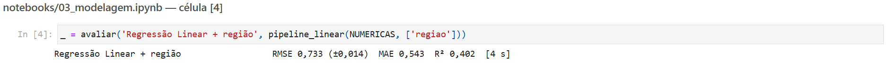
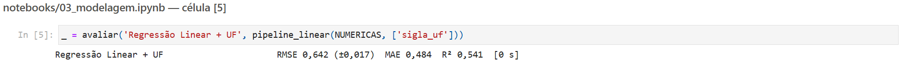
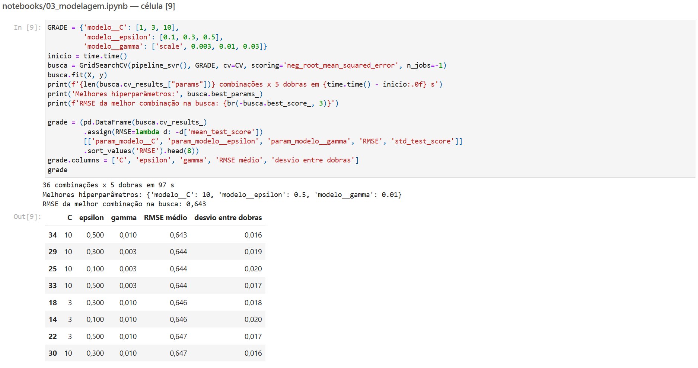
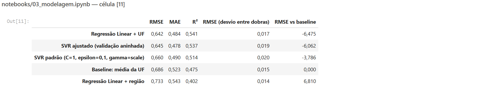
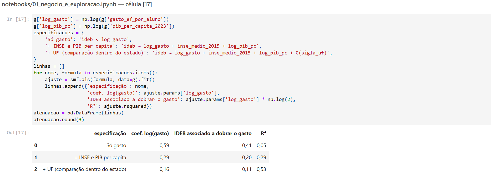
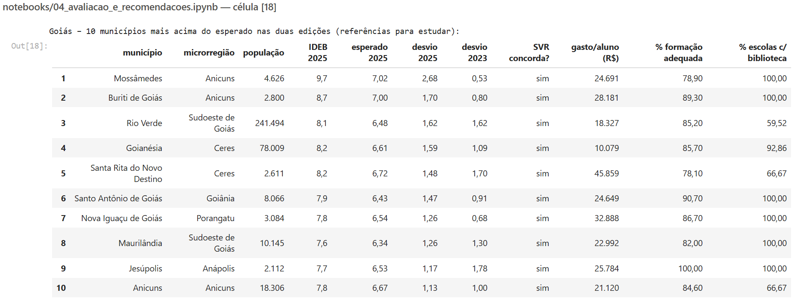

# Guia da apresentação – IDEB e investimentos municipais

Roteiro de fala da dupla, na ordem dos 7 itens do enunciado. Cada bloco traz os cards da apresentação, o que dizer, os números-chave e os prints do notebook executado que comprovam cada resultado.

- **Apresentação:** `docs/apresentacao/index.html` (abrir no navegador; setas ← → ou o botão laranja avançam card a card). Precisa de internet para carregar as bibliotecas visuais. Se a sala estiver sem rede, usar a cópia `docs/apresentacao/apresentacao.pdf`.
- **Duração sugerida:** 15 a 18 minutos de fala + perguntas. Cerca de 1 minuto por card.
- **Divisão sugerida:** a Pessoa A fala os itens 1, 2 e 4 (negócio, formulação e dados). A Pessoa B fala os itens 3, 5 e 6 (métodos, implementação e resultados). Os dois dividem o item 7 (recomendação e limitações).
- **Fonte de cada número:** `docs/diario_do_projeto.md` (Fases 11 a 20) e os notebooks em `notebooks/`. Todos os prints abaixo vêm dos notebooks executados do zero na validação final (Fase 19).

---

## Item 1 – Análise do negócio (Pessoa A, cerca de 2 min)

**Cards:** abertura, "O problema de negócio", "Da pergunta ao recorte".

**O que dizer**
- Somos uma equipe de apoio à gestão pública. A pergunta é: quais características dos municípios acompanham um IDEB maior, e qual IDEB seria esperado para cada município, dado o seu perfil?
- O valor para o gestor é ter uma **régua justa**: comparar cada município com outros parecidos, e não com a média nacional.
- O recorte saiu de uma pergunta de negócio: **quem financia cada etapa?** O ensino médio é estadual, e os anos finais são divididos. Os anos iniciais (1º ao 5º ano) da rede municipal são a etapa que a prefeitura financia quase sozinha. Por isso o gasto municipal conversa com esse resultado.

**Números-chave:** 5.241 municípios com IDEB em 2023 e 5.320 em 2025. 46% dos municípios atingem a meta 6,0 em 2023. Seis fontes oficiais, custo zero (BigQuery Sandbox).

---

## Item 2 – Formulação do problema de ML (Pessoa A, cerca de 2 min)

**Cards:** "Variáveis e fatores externos" e "A UF pesa".

**O que dizer**
- É **regressão supervisionada**: o alvo, o IDEB, é contínuo (0 a 10). Uma linha por município e ano.
- Treino com o IDEB 2023 e **teste fora do tempo** com o IDEB 2025, usado uma única vez no final. 2021 ficou de fora por causa da pandemia.
- Separamos as variáveis entre o que o gestor **não controla** (nível socioeconômico, PIB, ruralidade) e o que ele **controla** (formação docente, infraestrutura, gasto). As primeiras entram como controle, e as segundas são as alavancas.
- Fatores externos que afetam a análise: nível socioeconômico das famílias, políticas estaduais (o caso do Ceará), participação no SAEB, pandemia e qualidade da declaração do gasto.

**Números-chave:** média do IDEB de 4,77 no Norte e 6,35 no Sul. Goiás tem a 6ª maior mediana entre 26 UFs (6,2). Ceará: todos os municípios com INSE ficam acima da tendência nacional, em média 1,82 ponto.

**Print – checagem de que nenhuma variável do cálculo do IDEB entrou na base**

---

## Item 4 – Preparação dos dados (Pessoa A, cerca de 3 min)

> Apresentamos a preparação antes dos métodos porque os desafios de dados explicam várias escolhas de modelagem.

**Cards:** "Desafios de dados" e "Como evitamos vazamento".

**O que dizer**
- **Fonte corrompida:** os indicadores educacionais de 2023 e 2024 vieram com colunas trocadas na Base dos Dados. Goiânia aparecia com 4 alunos por turma. Detectamos comparando com 2022 e usamos 2022 nas duas safras.
- **Gasto declarado errado:** um município mineiro declarou R$ 1,28 bilhão em ensino fundamental para 6.697 alunos (R$ 191 mil por aluno). Gastos abaixo de R$ 1 mil ou acima de R$ 60 mil viraram ausentes (15 linhas).
- **Redundância:** grupos de colunas que somam 100% (formação, esforço docente, gestão, regularidade) viraram um indicador cada. De 54 colunas brutas chegamos a 24 features, com VIF máximo de 4,93.
- **Vazamento:** o IDEB é a nota do SAEB multiplicada pela taxa de aprovação. Nenhuma das duas, nem reprovação, abandono ou distorção idade-série, entra no modelo. Tudo que aprende com os dados (winsorização, imputação, padronização) fica dentro do `Pipeline`, ajustado só no treino de cada dobra.

**Números-chave:** INSE ausente em 4,5% (20,7% no RS). Gasto ausente em 0,8% em 2023 e 4,2% em 2025. 15 gastos implausíveis.

**Print – gastos implausíveis encontrados no notebook 01**

**Print – conjunto final de features (notebook 02)**

**Print – base de modelagem gravada e conferida (notebook 02)**

---

## Item 3 – Seleção do método (Pessoa B, cerca de 2 min)

**Cards:** "A proposta" (o card central, com o gráfico de Goiás) e "Seleção do método".

**O que dizer**
- A disciplina limita a escolha a seis métodos. **GMM, DBSCAN e Mean Shift** são agrupamentos não supervisionados: encontram perfis, mas não estimam o IDEB. **Regressão Logística** só serviria se a pergunta virasse "atingiu 6,0?", e perderia a informação de quanto falta.
- **Regressão Linear** é o modelo principal: com as features padronizadas, cada coeficiente diz quanto o IDEB esperado muda com cada fator, mantidos os demais. É o que o gestor precisa explicar.
- **SVR** (SVM para regressão, kernel RBF) é o desafiante: capta não linearidades e interações, mas não tem coeficientes.
- Comparamos tudo com um **baseline**: "o município tem o IDEB médio do seu estado".

---

## Item 5 – Implementação em Python (Pessoa B, cerca de 2 min)

**Cards:** "Pipeline em Python" e "Comparação na validação cruzada".

**O que dizer**
- Python com pandas, scikit-learn e statsmodels. Quatro notebooks: negócio e exploração, preparação, modelagem, avaliação.
- Validação cruzada **KFold com 5 dobras, embaralhada, semente 42**, igual para todos os modelos. Métricas: RMSE, MAE e R².
- O SVR foi ajustado com GridSearchCV (36 combinações de `C`, `epsilon` e `gamma`) e avaliado com **validação aninhada**, para não usar as mesmas dobras para escolher e medir.
- **O maior desafio da modelagem:** a primeira Regressão Linear, com região, **errou mais que o baseline** (0,733 contra 0,686). A região esconde o efeito do estado. Trocamos por UF e o erro caiu para 0,642, 6,5% menos que o baseline.

**Print – a Regressão Linear com região perde para o baseline (notebook 03)**

**Print – com UF, ela passa o baseline (notebook 03)**

**Print – busca em grade do SVR (notebook 03)**

**Print – comparação final na validação cruzada (notebook 03)**

**Print – VIF das features (notebook 03)**

---

## Item 6 – Avaliação e interpretação (Pessoa B, cerca de 4 min)

**Cards:** "Teste fora do tempo", "O país melhorou", "Fatores associados", "Quanto vale dobrar o gasto?", "Gasto e nível socioeconômico", "Priorização".

**O que dizer**
- No teste 2025 o erro sobe (RMSE de 0,745 na Regressão Linear), mas **a maior parte é viés**: o IDEB real ficou 0,35 ponto acima do previsto, porque o país melhorou entre as edições. Descontado esse deslocamento, o erro é de 0,658, perto da validação cruzada. A **ordem** dos municípios se mantém (Spearman de 0,70).
- O SVR errou 4,6% menos no teste (0,711). Mantivemos a escolha feita antes do teste, para não usar o teste como seleção, e verificamos o impacto: as classificações dos dois modelos concordam em 88,9% dos municípios.
- **Fatores associados**, dentro da mesma UF e mantido o resto: INSE (+5 pontos acompanham +0,31 de IDEB), % de docentes com superior (+10 p.p. acompanham +0,05), biblioteca, internet, laboratório, quadra e tempo integral (positivos e pequenos). Esforço docente e complexidade de gestão aparecem com sinal negativo.
- **Gasto:** dobrar o gasto por aluno acompanha +0,41 ponto sem controles, +0,20 com INSE e PIB, +0,11 dentro da mesma UF e +0,06 no modelo completo. Quem gasta mais tem, em média, alunos de nível socioeconômico mais alto. É confusão, e é por isso que associação não é causalidade.
- **Priorização:** o desvio em relação ao esperado se repete entre 2023 e 2025 (correlação de 0,66), então não é ruído. 534 municípios ficam abaixo do esperado nas duas edições, e em 300 deles os dois modelos concordam.

**Números-chave:** CV: R² de 0,541 (Regressão Linear) e 0,475 (baseline). Teste 2025: R² de 0,298 bruto e 0,452 sem o viés. Ceará +1,50 e Alagoas +0,84 em relação à UF mediana.

**Print – teste único em 2025 (notebook 04)**

**Print – coeficientes em unidades do gestor (notebook 04)**

**Print – exploração da confusão entre gasto e contexto (notebook 01)**

**Print – municípios acima e abaixo do esperado nas duas edições (notebook 04)**

**Print – concordância entre a Regressão Linear e o SVR (notebook 04)**

---

## Item 7 – Recomendação gerencial, riscos e limitações (os dois, cerca de 3 min)

**Cards:** "Goiás: estudo de caso", "Goiás: quem priorizar", "Recomendações", "Riscos e limitações" e o card final.

**O que dizer (Pessoa A: Goiás; Pessoa B: recomendações e limitações)**
- Em Goiás, 30 dos 237 municípios ficam abaixo do esperado nas duas edições, e o SVR concorda em 19. **Sete estão no Entorno de Brasília** (Santo Antônio do Descoberto, Novo Gama, Cidade Ocidental, Planaltina, Cristalina, Mimoso de Goiás e Vila Boa), e três na microrregião de Goiânia. Isso sugere uma ação regional, junto com o estado.
- Os municípios goianos abaixo do esperado **não gastam menos** que os que ficam acima (mediana de R$ 22,8 mil contra R$ 23,8 mil por aluno). O que os separa não está na base, e por isso o próximo passo é o diagnóstico em campo.
- Rio Verde e Goianésia ficam mais de 1 ponto acima do esperado nas duas edições, gastando abaixo da mediana do estado. São referências para estudar.
- Goiânia está dentro do esperado.
- **Recomendações:** (1) usar o IDEB esperado como régua; (2) diagnosticar primeiro os municípios que os dois modelos apontam; (3) aprender com quem está acima do esperado; (4) olhar a qualidade do gasto antes da quantidade; (5) testar as alavancas em pilotos avaliados; (6) ação regional no Entorno de Brasília; (7) recalibrar o modelo a cada edição.
- **Limitações:** associação não é causalidade; INSE de 2015; indicadores de 2022; Siconfi autodeclarado; redes pequenas instáveis; municípios sem IDEB fora da base; R² em torno de 0,5.

**Frase de fechamento:** "O modelo não diz onde investir. Ele diz onde olhar primeiro e com quem comparar."

**Print – Goiás, municípios abaixo do esperado nas duas edições (notebook 04)**

**Print – Goiás, municípios mais acima do esperado (notebook 04)**

---

## Cola de números

| Tema | Número |
|---|---|
| Municípios | 5.241 (2023) e 5.320 (2025); 329 sem IDEB em 2023 (5,9%) |
| Alvo 2023 | Média 5,79, mediana 5,8, desvio 0,95; 46% atingem 6,0 |
| Regiões | Norte 4,77; Nordeste 5,31; Centro-Oeste 5,93; Sudeste 6,19; Sul 6,35 |
| Associação com o IDEB (Spearman) | INSE 0,57; quadra 0,45; biblioteca 0,44; % sem superior −0,41; gasto 0,25 |
| Features | 54 colunas brutas → 24 features + UF; VIF máximo 4,93 |
| CV (RMSE / R²) | Baseline 0,686 / 0,475; RL + região 0,733 / 0,402; **RL + UF 0,642 / 0,541**; SVR ajustado 0,645 / 0,537 |
| SVR | C = 10, epsilon = 0,5, gamma = 0,01 |
| Teste 2025 (RMSE) | Baseline 0,800; RL 0,745; SVR 0,711; viés −0,35 (RL) |
| Teste 2025 sem o viés | RL 0,658; SVR 0,627; Spearman RL 0,70 e SVR 0,74 |
| Dobrar o gasto | +0,41 (sem controles) → +0,20 → +0,11 → +0,06 (modelo completo) |
| UF | CE +1,50; AL +0,84; GO +0,39; AP −1,09 (contra a UF mediana) |
| Priorização | 534 abaixo nas duas edições; 300 com consenso; 565 acima; correlação do desvio 0,66 |
| Goiás | 237 municípios; 30 abaixo (19 com consenso), 7 no Entorno de Brasília; 28 acima |

---

## Perguntas prováveis e respostas preparadas

**1. Por que não usar a taxa de aprovação ou a nota do SAEB, que explicariam muito mais?**
Porque o IDEB é calculado a partir delas. O modelo "acertaria" sem aprender nada útil, e o gestor não ganharia nenhuma informação nova. Por isso nem extraímos essas colunas, e a checagem automática confirma que nenhuma entrou.

**2. Se o SVR errou menos em 2025, por que a Regressão Linear é o modelo principal?**
A escolha foi feita na validação cruzada, onde os dois empataram (0,642 contra 0,645). Trocar o modelo depois de ver o teste seria usar o teste para escolher, e ele deixaria de ser um teste. Além disso, a Regressão Linear explica os fatores, o que o gestor precisa. Medimos o impacto prático da escolha: as classificações concordam em 88,9%, e recomendamos priorizar os 300 municípios em que os dois concordam.

**3. Um R² de 0,54 não é baixo?**
Para dados municipais, sem a nota da prova nem o fluxo escolar, é um resultado razoável: o baseline com a UF já explica 0,475, e o modelo acrescenta 6,6 pontos de R² com características municipais. A outra metade da variação vem do que a base não mede (gestão escolar, práticas pedagógicas). Por isso o esperado é apresentado como faixa de ±0,5 ponto e serve para priorizar, não para fixar meta.

**4. Usar a UF como variável não é "trapaça"?**
Não, porque a UF é conhecida antes do resultado e não faz parte do cálculo do IDEB. Ela capta o que é comum a todos os municípios de um estado (política estadual, regime de colaboração), e com ela os coeficientes passam a comparar municípios dentro do mesmo estado, que é a comparação justa para o gestor.

**5. Então o gasto não importa?**
O modelo não diz isso. Ele diz que, entre municípios parecidos, gastar mais por aluno, sozinho, acompanha uma diferença pequena no IDEB (+0,06 ponto ao dobrar o gasto). O que provavelmente pesa é como o recurso é usado, e isso a base não mede. É também por isso que o próximo passo é o diagnóstico em campo.

**6. Como vocês evitaram vazamento na validação cruzada?**
Regras fixas (valores implausíveis, logaritmos, resumos de grupos) foram aplicadas antes, porque não aprendem nada com os dados. Tudo que aprende (limites de winsorização, mediana da imputação, média e desvio da padronização, média da UF no baseline) fica dentro do `Pipeline` e é ajustado só no treino de cada dobra. O teste de 2025 não foi carregado no notebook de modelagem.

**7. Por que o modelo erra mais em 2025?**
Principalmente porque o IDEB subiu em média no país entre as edições, e um modelo treinado em 2023 não tem como saber disso. Descontado esse deslocamento, o erro fica perto do da validação cruzada. Também pesam a defasagem dos indicadores (de 2022) e o gasto de 2025 mais incompleto no Siconfi.

**8. Por que não usaram GMM, DBSCAN ou Mean Shift?**
São métodos de agrupamento, não supervisionados: encontram grupos de municípios parecidos, mas não estimam o IDEB, que é a pergunta do problema. O GMM poderia servir para segmentar perfis, mas a comparação com o esperado já cumpre o papel de "comparar com os parecidos".

**9. Os IDEBs de 9 e 10 no Ceará e em Alagoas não são erro?**
Não são erro de extração, e não os removemos. São coerentes com a política estadual de alfabetização do Ceará, em vigor desde 2007. Também não descartamos a hipótese de distorções de participação no SAEB, que exigiria outra investigação. O modelo subestima esses municípios (erro médio de 2,75 pontos), e eles aparecem como referências a estudar.

**10. Por que exigir duas edições abaixo do esperado?**
Porque redes pequenas oscilam: nas 20% menores, 12,9% dos municípios erram mais de 1 ponto. Exigir duas edições evita reagir a uma prova só. A correlação de 0,66 entre os desvios das duas edições mostra que existe um padrão persistente a ser captado.

**11. E os municípios sem IDEB?**
Ficam fora da base (5,9% em 2023), e o modelo não vale para eles. É um viés de seleção declarado. Para esses, a gestão precisa de outros indicadores (fluxo escolar, avaliações estaduais).

**12. Como provar que um investimento funciona?**
Com avaliação de impacto: implantar a ação em parte dos municípios priorizados, manter um grupo de comparação parecido e medir a diferença nas edições seguintes do IDEB. O modelo ajuda a escolher onde testar e com quem comparar.

**13. Por que o INSE de 2015?**
É o único disponível na Base dos Dados. Funciona como proxy estrutural (o nível socioeconômico muda devagar), mas é uma limitação declarada e a primeira variável a atualizar.

---

## Checklist antes de apresentar

- [ ] Abrir `docs/apresentacao/index.html` no computador da sala e testar a navegação com as setas.
- [ ] Ter `docs/apresentacao/apresentacao.pdf` no pendrive, caso falte internet.
- [ ] Revisar a cola de números acima.
- [ ] Combinar a divisão de fala entre a dupla.
- [ ] Ter o notebook 04 aberto em outra aba, para mostrar ao vivo se pedirem.
