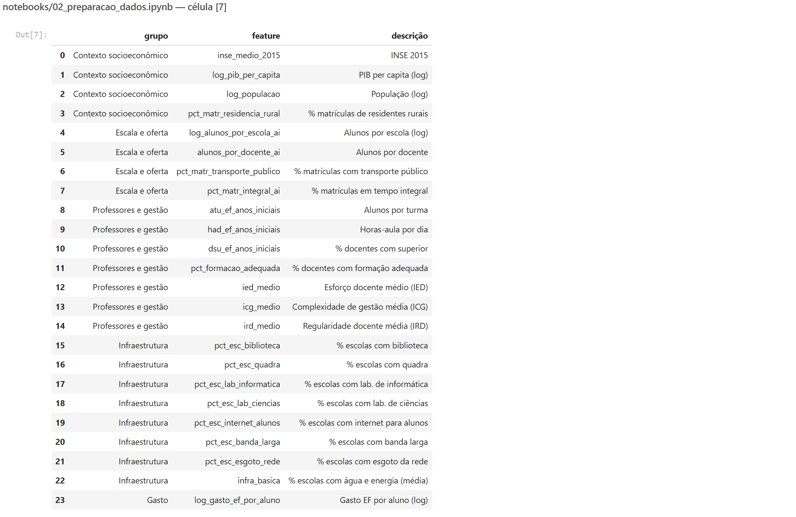
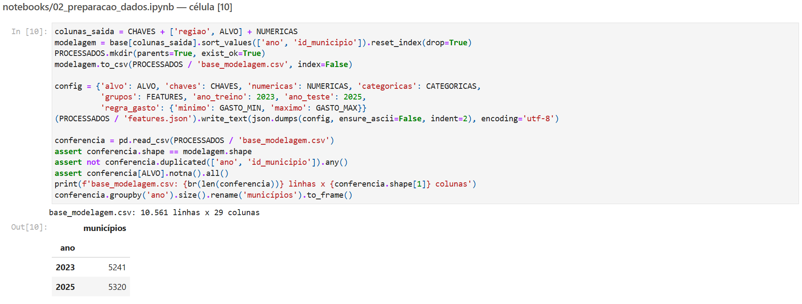
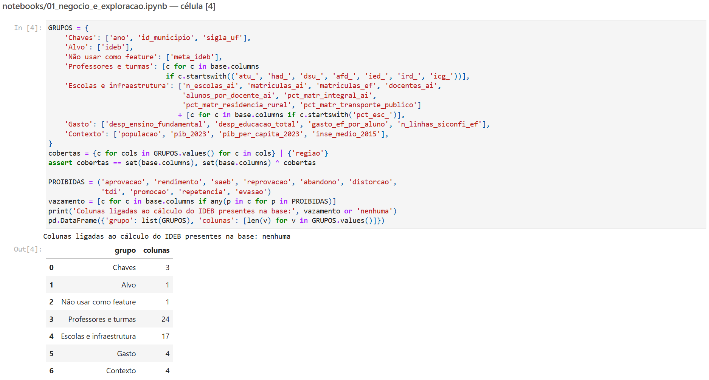
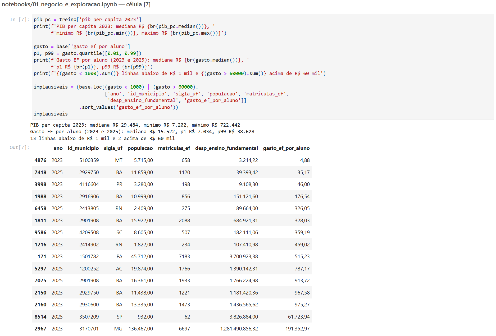
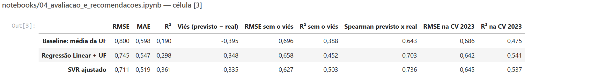
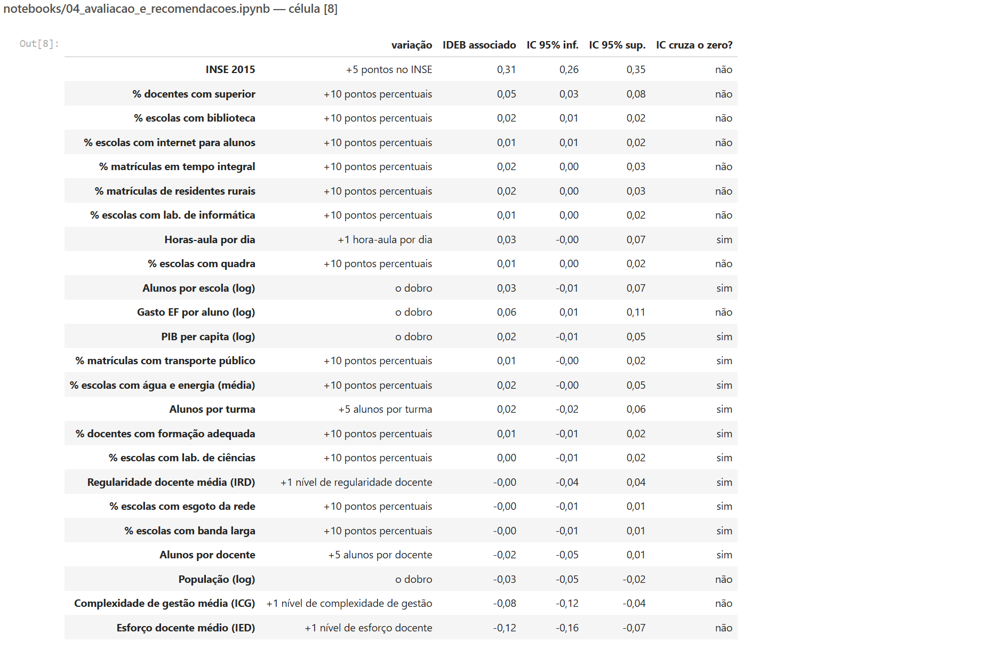
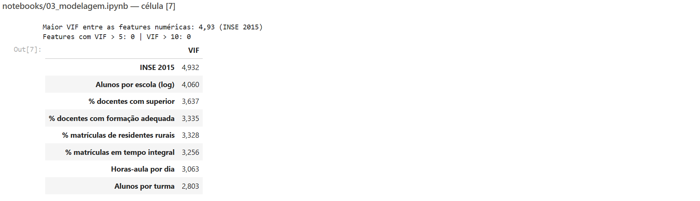
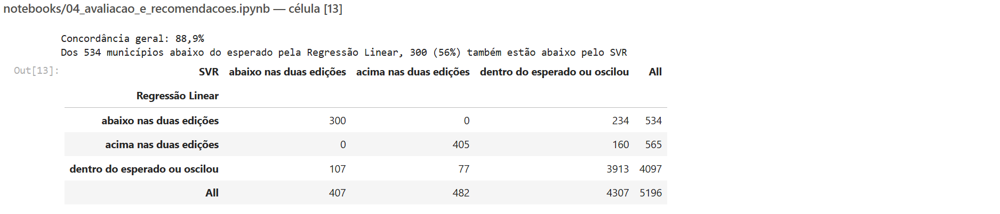
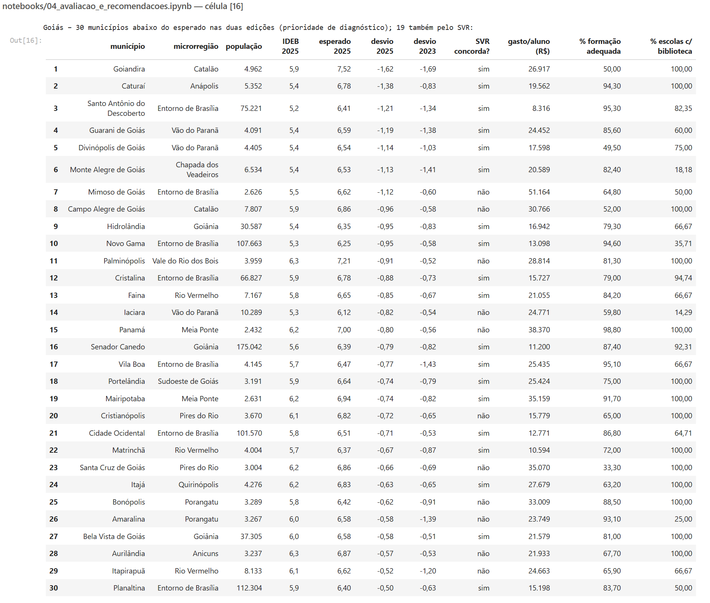

# Guia da apresentação – IDEB e investimentos municipais

Roteiro da dupla para a apresentação do Problema 4. O guia tem quatro partes: (1) a justificativa da escolha dos algoritmos, (2) a fala de cada slide, com os números e os prints do notebook que comprovam cada resultado, (3) as perguntas prováveis da avaliação por pares, com respostas, e (4) uma cola de números e o checklist.

- **Arquivos:** `docs/apresentacao/index.html` (abrir no navegador e avançar com as setas ← →). Precisa de internet para carregar as bibliotecas visuais. Sem rede, use `docs/apresentacao/apresentacao.pdf`, que tem os mesmos 24 slides, na mesma numeração deste guia.
- **Duração:** cerca de 19 minutos de fala, mais as perguntas. Se o tempo for curto, os slides 12, 17 e 18 podem ser passados em 10 segundos cada.
- **Divisão de fala:** a Pessoa A apresenta os slides 1 a 8 (negócio, dados e proposta), 20 e 21 (Goiás) e 24 (fechamento). A Pessoa B apresenta os slides 9 a 19 (métodos, implementação e resultados), 22 e 23 (recomendações e limitações).
- **Fonte dos números:** `docs/diario_do_projeto.md` e os notebooks executados do zero na validação final. Os prints vêm desses notebooks.

---

## 1. Justificativa da escolha dos algoritmos

### O ponto de partida: o tipo de problema

O alvo é o IDEB dos anos iniciais da rede municipal, um número contínuo de 0 a 10, conhecido para cada município. Temos exemplos rotulados (município, características, IDEB), então o problema é de **aprendizado supervisionado**. Como o alvo é contínuo, a tarefa é **regressão**. O gestor também precisa de duas coisas além da previsão: saber **quais fatores** acompanham as diferenças e **quanto** cada um pesa, e conseguir **explicar** a régua usada para comparar municípios. Interpretabilidade, portanto, é requisito, e não detalhe.

### Os seis métodos permitidos pela disciplina

| Método | Tipo | Estima o IDEB? | Como se interpreta | Papel no trabalho |
|---|---|---|---|---|
| Regressão Linear | Supervisionado, regressão | Sim | Coeficientes com intervalo de confiança | **Principal** |
| SVM para regressão (SVR, kernel RBF) | Supervisionado, regressão | Sim | Indireta: permutation importance e dependência parcial | **Desafiante** |
| Regressão Logística | Supervisionado, classificação | Não: só responde "atingiu 6,0?" | Razões de chance | Complementar |
| GMM | Não supervisionado (mistura de gaussianas) | Não | Perfis de municípios | Descartado |
| DBSCAN | Não supervisionado (densidade) | Não | Grupos densos e ruído | Descartado |
| Mean Shift | Não supervisionado (modas da densidade) | Não | Grupos em torno das modas | Descartado |

### Por que a Regressão Linear é o modelo principal

1. **Responde à pergunta do gestor.** Com as features padronizadas, cada coeficiente diz quanto o IDEB esperado muda quando o fator aumenta um desvio-padrão, mantidos os demais. Calculamos intervalos de confiança de 95% com erros-padrão robustos (HC3) e convertemos os coeficientes para unidades de gestão, como "+10 pontos percentuais de docentes com superior".
2. **Compara dentro do mesmo estado.** Com a UF em one-hot, o modelo funciona como uma regressão com efeito fixo por estado: os coeficientes comparam municípios da mesma UF, o que é a comparação justa para o gestor.
3. **É transparente.** Decisão orçamentária pública precisa ser explicada e auditada. Uma fórmula linear, com os pesos à vista, pode ser apresentada a uma secretaria e a um tribunal de contas.
4. **Não perdeu em desempenho.** Na validação cruzada, a Regressão Linear com UF teve RMSE de 0,642, contra 0,645 do SVR ajustado. A diferença é menor que a variação entre as dobras (cerca de 0,017).
5. **Os pressupostos foram conferidos.** O VIF máximo foi de 4,93, abaixo do limite usual de 5, e os resíduos ficaram centrados em zero. As limitações da linearidade foram atenuadas com logaritmo nas variáveis assimétricas e winsorização em p1/p99.

### Por que o SVR é o desafiante

1. **Capta o que a reta não capta.** O kernel RBF modela não linearidades e interações, como um gasto com retorno decrescente ou um efeito da formação docente que depende do tamanho da rede.
2. **É robusto a ruído.** A perda insensível a epsilon ignora erros pequenos, o que combina com um alvo que oscila entre edições.
3. **Foi ajustado com cuidado.** `C`, `epsilon` e `gamma` foram escolhidos por GridSearchCV (36 combinações). O erro foi medido com validação cruzada aninhada, para não usar as mesmas dobras para escolher e para medir. Melhor combinação: `C = 10`, `epsilon = 0,5`, `gamma = 0,01`.
4. **O custo é a interpretação.** O SVR não tem coeficientes. Usamos permutation importance e dependência parcial para entender o que ele aprendeu. Os dois fatores principais são os mesmos da Regressão Linear (UF e INSE), e o efeito parcial do gasto também é pequeno (+0,12 ponto entre os percentis 5 e 95, contra +0,09 na Regressão Linear).

### Por que a Regressão Logística ficou como complementar

Ela exige transformar a pergunta em classificação, por exemplo "o município atingiu o IDEB 6,0?". Funciona (ROC AUC de 0,878, contra 0,839 do baseline por UF), mas trata um IDEB de 5,9 e um de 4,0 como a mesma resposta, "não atingiu". Para planejar, o gestor precisa saber **quanto** falta, e isso só a regressão do IDEB contínuo informa.

### Por que GMM, DBSCAN e Mean Shift foram descartados

São métodos de agrupamento, sem alvo: encontram grupos de municípios parecidos, mas não estimam o IDEB, que é a pergunta do enunciado. A ideia útil por trás deles, "comparar cada município com os parecidos", já é cumprida pelo IDEB esperado, que compara cada município com outros de perfil semelhante no mesmo estado.

### O baseline

Todo modelo foi comparado com a previsão mais simples que um analista faria sem modelo: "o município tem o IDEB médio do seu estado". Só vale a pena usar um modelo que erre menos do que isso. Esse baseline derrubou a nossa primeira especificação (Regressão Linear com região), e foi o que nos levou a usar a UF.

### Como a escolha foi validada

- Mesmas 5 dobras para todos os modelos (KFold embaralhado, semente 42), só com a safra 2023.
- Três métricas: RMSE (erro na escala do IDEB, penaliza erros grandes), MAE (erro típico em pontos) e R² (parcela da variação explicada).
- Pré-processamento dentro do `Pipeline`, ajustado só no treino de cada dobra.
- Teste fora do tempo com o IDEB 2025, usado uma única vez, depois de todas as escolhas.

### O que o teste de 2025 mostrou sobre a escolha

No teste, o SVR errou 4,6% menos que a Regressão Linear (RMSE de 0,711 contra 0,745). Mantivemos a escolha feita antes do teste: trocar de modelo depois de ver o resultado seria usar o teste para escolher, e ele deixaria de ser um teste. Medimos então se a escolha muda a decisão. As classificações dos dois modelos concordam em 88,9% dos municípios, nenhum município passa de "abaixo do esperado" para "acima" e a recomendação usa a lista de consenso (os 300 municípios que os dois modelos apontam). Para a próxima edição do IDEB, os dois modelos devem ser comparados de novo.

### Em uma frase, para a fala

"Escolhemos a Regressão Linear porque ela errou o mesmo que o SVR na validação e, ao contrário dele, explica quanto cada fator pesa, que é o que o gestor precisa. O SVR ficou como desafiante, e a lista final de prioridades usa os municípios em que os dois concordam."

---

## 2. Roteiro slide a slide

### Slide 1 – Abertura · Pessoa A · 40 s

> Boa noite. Somos [nomes da dupla], e vamos apresentar o Problema 4, de Política e Gestão Pública. A pergunta é: quais características dos municípios acompanham um IDEB maior, e quem está abaixo do esperado para o seu perfil? O número na tela é o ponto de partida: em 2023, só 46% dos municípios atingiram a meta nacional de 6,0 nos anos iniciais da rede municipal. É na outra metade que o planejamento orçamentário precisa agir.

### Slide 2 – O problema de negócio · Pessoa A · 50 s

> Nós nos colocamos no lugar de uma equipe de gestão pública que planeja o orçamento da educação. Ela não precisa só de uma previsão. Precisa saber quais fatores acompanham as diferenças entre municípios e qual IDEB seria justo esperar de cada um. Para isso, cruzamos seis fontes oficiais, do INEP, do Tesouro Nacional e do IBGE, pelo código do município. São 5.241 municípios em 2023 e 5.320 em 2025. A extração foi feita no BigQuery, no modo gratuito, então o custo foi zero.

### Slide 3 – Da pergunta ao recorte · Pessoa A · 60 s

> A primeira decisão foi o recorte, e ela veio do negócio, não da técnica. Perguntamos: quem financia cada etapa? O ensino médio é quase todo estadual, e os anos finais são divididos entre estado e prefeitura. Os anos iniciais, do 1º ao 5º ano, são a etapa que a prefeitura financia quase sozinha. Então, para falar de investimento municipal, o alvo é o IDEB dos anos iniciais da rede municipal. Cada linha da base é um município num ano. Treinamos com 2023 e testamos com 2025, uma edição que o modelo nunca viu. 2021 ficou de fora por causa da pandemia. Como o IDEB é um número contínuo, a tarefa é regressão supervisionada.

### Slide 4 – Variáveis consideradas e quem as controla · Pessoa A · 60 s

> Organizamos as variáveis pelo que o gestor controla. O contexto socioeconômico, como o nível socioeconômico das famílias, o PIB per capita e a parcela de alunos da zona rural, ele não controla no curto prazo: essas variáveis entram como controle, para comparar municípios parecidos. Professores e gestão ele controla em parte, por concurso, formação e lotação. Infraestrutura e gasto ele controla. E há fatores externos que nenhuma variável municipal mede, como a política educacional do estado e a participação dos alunos na prova. Uma regra valeu para tudo: nada que entra no cálculo do IDEB, como aprovação ou nota do SAEB, entrou no modelo. No fim ficaram 24 variáveis, mais a UF.

**Números-chave:** 54 colunas brutas → 24 features + UF. INSE ausente em 4,5% dos municípios em 2023 (20,7% no RS).

**Print – conjunto final de features (notebook 02)**

**Print – base de modelagem gravada e conferida (notebook 02)**

### Slide 5 – IDEB 2023 por UF · Pessoa A · 45 s

> Este gráfico mostra o IDEB mediano de cada estado, com a faixa entre o primeiro e o terceiro quartil. A diferença é grande: a média vai de 4,77 no Norte a 6,35 no Sul. Goiás, em azul, tem a sexta maior mediana do país, 6,2. Isso já indica que o estado pesa muito. Por isso o nosso ponto de comparação, o baseline, é a média do IDEB da UF: qualquer modelo precisa fazer melhor do que isso.

### Slide 6 – INSE e IDEB, com o Ceará em destaque · Pessoa A · 50 s

> O nível socioeconômico é a variável mais associada ao IDEB, com correlação de 0,57. Mas reparem nos pontos laranja: são municípios do Ceará. Eles têm nível socioeconômico baixo e IDEB acima da tendência, em média 1,82 ponto acima. Não é erro da base. O Ceará mantém desde 2007 uma política estadual de alfabetização em parceria com os municípios. É um exemplo de fator externo, e ele vai reaparecer na modelagem.

### Slide 7 – Desafios de dados, antes de modelar · Pessoa A · 75 s

> Antes de modelar, encontramos três problemas. O primeiro foi na fonte: os indicadores educacionais de 2023 e 2024 vieram com colunas trocadas na Base dos Dados. Goiânia aparecia com 4 alunos por turma, quando o valor real é 24,5. Detectamos comparando com 2022 e passamos a usar 2022 nas duas safras. O segundo foi o gasto declarado no Siconfi: um município mineiro declarou 191 mil reais por aluno, e outros menos de 50 reais. Valores abaixo de mil ou acima de 60 mil reais por aluno viraram ausentes, 15 casos. O terceiro, e mais importante, é o vazamento: o IDEB é a nota do SAEB multiplicada pela taxa de aprovação. Se essas variáveis entrassem, o modelo acertaria sem aprender nada útil. Nenhuma entrou. E tudo que aprende com os dados, como a imputação e a padronização, fica dentro do Pipeline, ajustado só no treino.

**Números-chave:** 15 gastos implausíveis. 0 variáveis do cálculo do IDEB no modelo.

**Print – checagem de que nenhuma variável do cálculo do IDEB entrou na base (notebook 01)**

**Print – gastos implausíveis encontrados (notebook 01)**

### Slide 8 – A proposta · Pessoa A · 50 s

> Esta é a proposta do trabalho. Em vez de comparar cada município com a média nacional, comparamos com o IDEB esperado para municípios de perfil parecido no mesmo estado. É mais justo: um município pobre com IDEB 5,5 pode estar acima do esperado, e um município rico com 6,0 pode estar abaixo. O gráfico mostra Goiás. Os pontos laranja ficam abaixo do esperado nas duas edições, e os azuis, acima. Os de baixo são candidatos a diagnóstico; os de cima, referências para aprender.

**Transição:** "Agora [nome da Pessoa B] explica como chegamos a esse IDEB esperado."

### Slide 9 – Seleção do método · Pessoa B · 75 s

> A disciplina limitou a escolha a seis métodos. Três deles, GMM, DBSCAN e Mean Shift, são agrupamentos não supervisionados: encontram grupos de municípios parecidos, mas não estimam o IDEB, que é a nossa pergunta. A Regressão Logística só serviria se a pergunta virasse "atingiu 6,0, sim ou não?", e aí perderíamos a informação de quanto falta. Ficamos com dois modelos de regressão. A Regressão Linear é o principal: com as variáveis padronizadas, cada coeficiente diz quanto o IDEB esperado muda com cada fator, mantidos os demais, e é isso que o gestor precisa explicar. O SVR, a versão do SVM para regressão, com kernel RBF, é o desafiante: capta relações não lineares, mas não tem coeficientes. E os dois precisam superar o baseline da média da UF.

### Slide 10 – Pipeline em Python · Pessoa B · 50 s

> A implementação é em Python, com pandas, scikit-learn e statsmodels, em quatro notebooks. O código na tela é o centro do projeto. O pré-processamento fica dentro do Pipeline: limitamos os valores extremos ao 1º e ao 99º percentil, preenchemos os ausentes com a mediana e padronizamos. A UF entra em one-hot. Como tudo isso está dentro do Pipeline, em cada dobra da validação cruzada esses ajustes são aprendidos só com o treino daquela dobra. A validação é KFold com cinco dobras e semente fixa, igual para todos os modelos. No SVR, os hiperparâmetros C, epsilon e gamma foram escolhidos por busca em grade, com validação aninhada.

**Print – busca em grade do SVR (notebook 03)**

### Slide 11 – Comparação dos modelos na validação cruzada · Pessoa B · 60 s

> Aqui está o principal desafio da modelagem. A nossa primeira Regressão Linear, com a região, errou mais que o baseline: RMSE de 0,733 contra 0,686. Ou seja, com 24 variáveis ela foi pior do que simplesmente usar a média do estado. O motivo é o que vimos no Ceará: a região junta estados muito diferentes. Trocamos a região pela UF, e o erro caiu para 0,642, 6,5% abaixo do baseline. O SVR ajustado chegou a 0,645, praticamente empatado. Com o empate, ficamos com a Regressão Linear, que explica os fatores.

**Números-chave:** RMSE: baseline 0,686; Regressão Linear + região 0,733; Regressão Linear + UF 0,642; SVR ajustado 0,645.

**Print – a Regressão Linear com região perde para o baseline (notebook 03)**

**Print – com UF, ela supera o baseline (notebook 03)**

**Print – comparação final na validação cruzada (notebook 03)**

### Slide 12 – Ganho de R² por bloco de variáveis · Pessoa B · 40 s

> Este gráfico mostra quanto cada grupo de variáveis acrescenta ao R², adicionando um bloco por vez depois da UF. O contexto socioeconômico é o que mais acrescenta. Escala, professores e infraestrutura somam cerca de 0,01 cada. E o gasto por aluno, quando entra por último, não acrescenta nada: a informação que ele carrega já estava nas outras variáveis. Guardem esse resultado, porque ele volta quando falarmos de investimento.

### Slide 13 – Teste fora do tempo: IDEB 2025 · Pessoa B · 50 s

> Com tudo escolhido, testamos uma única vez em 2025. O erro subiu, mas a maior parte é viés: o IDEB real ficou, em média, 0,35 ponto acima do previsto, porque o país melhorou entre as edições, e um modelo treinado em 2023 não tem como saber disso. Descontado esse deslocamento, a variação explicada foi de 39% no baseline, 45% na Regressão Linear e 50% no SVR. E a ordem dos municípios se manteve, com correlação de 0,70 entre previsto e real na Regressão Linear.

**Números-chave:** RMSE em 2025: baseline 0,800; Regressão Linear 0,745; SVR 0,711. Sem o viés: 0,696, 0,658 e 0,627.

**Print – teste único em 2025 (notebook 04)**

### Slide 14 – Previsto x real em 2025 · Pessoa B · 45 s

> Cada ponto é um município. A linha cinza é "previsto igual a real", e a laranja é a mesma linha deslocada em 0,35. Os pontos acompanham a laranja: o modelo acerta a posição relativa e erra o nível. Para priorizar, o que importa é a posição. Um registro honesto: no teste, o SVR errou 4,6% menos que a Regressão Linear. Não trocamos de modelo, porque a escolha foi feita antes do teste, mas medimos se isso muda a decisão. Mostramos isso daqui a pouco.

### Slide 15 – Coeficientes da Regressão Linear · Pessoa B · 60 s

> Este é o resultado que responde à pergunta do gestor. Cada ponto mostra quanto o IDEB muda quando o fator aumenta um desvio-padrão, comparando municípios do mesmo estado e mantido o resto. Azul é positivo, vermelho é negativo, e cinza quer dizer que o intervalo de confiança cruza o zero. O nível socioeconômico domina: 5 pontos a mais no INSE acompanham 0,31 ponto de IDEB. Depois vêm a parcela de docentes com ensino superior, com 0,05 ponto a cada 10 pontos percentuais, e a infraestrutura pedagógica: biblioteca, internet, laboratório, quadra e tempo integral. Esforço docente alto e escolas com gestão complexa acompanham IDEB menor. Antes de interpretar, conferimos a multicolinearidade: nenhum VIF passou de 5.

**Print – coeficientes em unidades do gestor (notebook 04)**

**Print – VIF das features (notebook 03)**

### Slide 16 – Quanto vale dobrar o gasto por aluno? · Pessoa B · 45 s

> Agora a pergunta que todo gestor faz: gastar mais aumenta o IDEB? Sem nenhum controle, dobrar o gasto por aluno acompanha 0,41 ponto de IDEB. Controlando o nível socioeconômico e o PIB, cai para 0,20. Comparando dentro da mesma UF, 0,11. No modelo completo, 0,06. A associação vai encolhendo à medida que o contexto entra.

**Print – a associação do gasto encolhe com os controles (notebook 01)**

### Slide 17 – Gasto por aluno e IDEB por faixa de INSE · Pessoa B · 40 s

> O gráfico mostra por quê. A linha preta, com todos os municípios, sobe bastante do menor para o maior gasto. Mas, dentro de cada faixa de nível socioeconômico, a subida é bem menor. Quem gasta mais tem, em média, alunos de nível socioeconômico mais alto: no quintil de maior gasto, 45% dos municípios têm INSE alto. Isso é confusão, e é o exemplo concreto de que associação não é causalidade.

### Slide 18 – Leitura dos resultados · Pessoa B · 20 s

> A nossa leitura é esta: entre municípios parecidos, gastar mais por aluno, sozinho, acompanha uma diferença pequena no IDEB. O que provavelmente pesa é como o recurso é usado, e isso a base não mede.

### Slide 19 – Priorização · Pessoa B · 50 s

> Para transformar o modelo em decisão, criamos uma regra. Um município fica abaixo do esperado quando o IDEB real está pelo menos meio ponto abaixo do esperado em 2023 e também em 2025. Exigimos duas edições porque redes pequenas oscilam. E o desvio se repete: a correlação entre as duas edições é de 0,66, então não é ruído. São 534 municípios abaixo do esperado. Aqui entra o teste com o SVR: os dois modelos concordam em 88,9% das classificações, e em 300 municípios os dois apontam abaixo do esperado. Essa é a lista principal.

**Transição:** "Agora [nome da Pessoa A] mostra o que isso significa para Goiás."

**Print – municípios acima e abaixo do esperado nas duas edições (notebook 04)**

**Print – concordância entre a Regressão Linear e o SVR (notebook 04)**

### Slide 20 – Goiás: estudo de caso · Pessoa A · 50 s

> Em Goiás, dos 237 municípios com as duas edições, 30 ficam abaixo do esperado nas duas, e o SVR concorda em 19. Sete deles estão no Entorno de Brasília, como Novo Gama, Planaltina e Cidade Ocidental, a maioria cidades de periferia metropolitana. Isso sugere uma ação regional, em conjunto com o estado. Um dado importante: esses municípios não gastam menos que os que ficam acima do esperado. A mediana é de 22,8 mil reais por aluno, contra 23,8 mil. Do outro lado, 28 municípios ficam acima do esperado nas duas edições, como Rio Verde e Goianésia, que gastam abaixo da mediana do estado. Goiânia fica dentro do esperado.

**Print – Goiás, municípios mais acima do esperado (notebook 04)**

### Slide 21 – Goiás: primeiros municípios a diagnosticar · Pessoa A · 40 s

> Esta é a lista dos primeiros municípios para diagnóstico: os oito maiores desvios entre os 19 que os dois modelos apontam. Goiandira, por exemplo, tinha IDEB esperado de 7,5 em 2025 e ficou com 5,9, e o desvio se repetiu em 2023. A lista completa, com os 30, está no notebook 04. O próximo passo para esses municípios não é cortar nem mandar recurso: é uma visita técnica para entender o que está acontecendo.

**Transição:** "Para fechar, [nome da Pessoa B] apresenta as recomendações e as limitações."

**Print – Goiás, municípios abaixo do esperado nas duas edições (notebook 04)**

### Slide 22 – Recomendações para a gestão · Pessoa B · 60 s

> Estas são as nossas recomendações. Primeira: usar o IDEB esperado como régua, sempre como faixa de mais ou menos meio ponto, e não como meta exata. Segunda: diagnosticar em campo primeiro os 300 municípios em que os dois modelos concordam, 19 deles em Goiás. Terceira: aprender com os 565 que superam o esperado. Quarta: olhar a qualidade do gasto antes da quantidade. Quinta: testar as alavancas, como formação docente, biblioteca e tempo integral, em pilotos avaliados, com grupo de comparação. Sexta: fazer uma ação regional no Entorno de Brasília e recalibrar o modelo a cada edição do IDEB.

### Slide 23 – Riscos e limitações · Pessoa B · 45 s

> E as limitações, que fazem parte do resultado. Associação não é causalidade: os coeficientes não medem o efeito de investir. O INSE é de 2015, e os indicadores docentes, de 2022. O gasto do Siconfi é autodeclarado. Redes pequenas oscilam, e por isso exigimos duas edições. Os municípios sem IDEB, 5,9% do país, ficam fora da análise. E o R² fica em torno de 0,5: metade da diferença entre municípios vem do que a base não mede.

### Slide 24 – Conclusão · Pessoa A · 20 s

> Para fechar: o modelo não diz onde investir. Ele diz onde olhar primeiro e com quem comparar. Obrigado. Ficamos à disposição para as perguntas.

---

## 3. Perguntas prováveis e respostas

### Negócio e recorte

**1. Por que só os anos iniciais e a rede municipal?**
Porque é a etapa que a prefeitura financia quase sozinha. No ensino médio, a oferta é estadual, e nos anos finais ela é dividida entre estado e prefeitura. Se misturássemos as etapas, o gasto municipal não conversaria com o resultado medido.

**2. Por que usar o Brasil inteiro, e não só Goiás?**
Goiás tem 246 municípios, poucos para estimar 24 variáveis com segurança. Com o Brasil, o modelo aprende com mais de 5 mil municípios, e a UF no modelo garante que cada município goiano seja comparado com outros de Goiás. Goiás entra como estudo de caso.

**3. O enunciado permitia dados sintéticos. Por que não usaram?**
Numa base simulada, as relações entre as variáveis seriam as que nós programássemos, e o modelo apenas redescobriria as nossas premissas. Como existem dados públicos reais e de boa qualidade, preferimos enfrentar os problemas reais (fonte corrompida, gasto mal declarado), que fazem parte do aprendizado.

### Dados e vazamento

**4. Por que não usar a taxa de aprovação ou a nota do SAEB, que explicariam muito mais?**
Porque o IDEB é calculado a partir delas. O modelo acertaria sem aprender nada útil, e o gestor não ganharia nenhuma informação nova. Por isso nem extraímos essas colunas, e a checagem automática confirma que nenhuma entrou.

**5. Como vocês evitaram vazamento na validação cruzada?**
Regras fixas, que não aprendem com os dados (valores implausíveis, logaritmos, resumos de grupos de colunas), foram aplicadas antes. Tudo que aprende (limites de winsorização, mediana da imputação, média e desvio da padronização, média da UF no baseline) fica dentro do `Pipeline` e é ajustado só no treino de cada dobra. A safra 2025 nem foi carregada no notebook de modelagem.

**6. Por que winsorizar e usar logaritmo?**
População, PIB per capita e gasto por aluno são muito assimétricos: no log, uma mesma variação percentual tem o mesmo peso em municípios pequenos e grandes. A winsorização em p1/p99 limita a influência de valores extremos na Regressão Linear sem descartar municípios, e os limites são aprendidos só no treino.

**7. Por que o INSE de 2015 e os indicadores docentes de 2022?**
O INSE de 2015 é o único disponível na Base dos Dados, e os indicadores de 2023 e 2024 estão corrompidos nessa fonte. Como nível socioeconômico e formação docente mudam devagar, funcionam como características estruturais. São limitações declaradas, e as primeiras variáveis a atualizar.

**8. Os IDEBs de 9 e 10 no Ceará e em Alagoas não são erro?**
Não são erro de extração, e não os removemos. São coerentes com a política estadual de alfabetização do Ceará, em vigor desde 2007. Também não descartamos a hipótese de distorções de participação no SAEB, que exigiria outra investigação. O modelo subestima esses municípios (erro médio de 2,75 pontos), e eles aparecem como referências a estudar.

### Método

**9. Se o SVR errou menos em 2025, por que a Regressão Linear é o modelo principal?**
A escolha foi feita na validação cruzada, onde os dois empataram (0,642 contra 0,645). Trocar o modelo depois de ver o teste seria usar o teste para escolher, e ele deixaria de ser um teste. Além disso, a Regressão Linear explica os fatores, o que o gestor precisa. Medimos o impacto prático: as classificações concordam em 88,9%, e a lista principal usa os 300 municípios de consenso.

**10. Por que não usaram GMM, DBSCAN ou Mean Shift?**
São métodos de agrupamento, não supervisionados: encontram grupos de municípios parecidos, mas não estimam o IDEB, que é a pergunta do problema. A ideia de "comparar com os parecidos" já é cumprida pelo IDEB esperado.

**11. Usar a UF como variável não é "trapaça"?**
Não, porque a UF é conhecida antes do resultado e não faz parte do cálculo do IDEB. Ela capta o que é comum a todos os municípios de um estado (política estadual, regime de colaboração). Com ela, os coeficientes comparam municípios do mesmo estado, que é a comparação justa para o gestor.

**12. O que é validação aninhada, e por que usá-la?**
Se a mesma validação cruzada serve para escolher os hiperparâmetros do SVR e para medir o erro, o erro sai otimista. Na validação aninhada, em cada uma das cinco dobras externas a busca em grade roda de novo, só com o treino daquela dobra, e o erro é medido na dobra que a busca não viu. Assim o SVR é comparado com a Regressão Linear em condições iguais.

### Métricas e validação

**13. Um R² de 0,54 não é baixo?**
Para dados municipais, sem a nota da prova nem o fluxo escolar, é um resultado razoável. O baseline com a UF já explica 0,475, e o modelo acrescenta 6,6 pontos de R² com características municipais. A outra metade da variação vem do que a base não mede (gestão escolar, práticas pedagógicas). Por isso o esperado é apresentado como faixa de ±0,5 ponto e serve para priorizar, não para fixar meta.

**14. Por que RMSE, MAE e R²?**
O RMSE está na escala do IDEB e pesa mais os erros grandes, que são os que levariam a priorizar o município errado. O MAE é o erro típico, mais fácil de explicar ("o modelo erra em média meio ponto"). O R² mostra quanto da diferença entre municípios o modelo explica. No teste, acrescentamos o viés e a correlação de ordem, porque para priorizar importa a posição relativa.

**15. Por que testar em 2025, e não separar uma parte aleatória de 2023?**
Porque o uso real é esse: treinar com o que já se conhece e aplicar na edição seguinte. Uma separação aleatória dentro de 2023 não revelaria, por exemplo, a alta média de 0,35 ponto entre as edições, que só aparece quando o modelo enfrenta um ano novo.

**16. Por que o modelo erra mais em 2025?**
Principalmente porque o IDEB subiu, em média, no país entre as edições, e um modelo treinado em 2023 não tem como saber disso. Descontado esse deslocamento, o erro fica perto do da validação cruzada. Também pesam a defasagem dos indicadores (de 2022) e o gasto de 2025 mais incompleto no Siconfi.

### Interpretação e decisão

**17. Então o gasto não importa?**
O modelo não diz isso. Ele diz que, entre municípios parecidos, gastar mais por aluno, sozinho, acompanha uma diferença pequena no IDEB (+0,06 ponto ao dobrar o gasto). O que provavelmente pesa é como o recurso é usado, e isso a base não mede. Por isso o próximo passo é o diagnóstico em campo.

**18. Por que exigir duas edições abaixo do esperado?**
Porque redes pequenas oscilam: nas 20% menores, 12,9% dos municípios erram mais de 1 ponto. Exigir duas edições evita reagir a uma prova só. A correlação de 0,66 entre os desvios das duas edições mostra que existe um padrão persistente a ser captado.

**19. O modelo poderia ser usado para cortar recursos de quem está acima do esperado?**
Não recomendamos. Isso puniria justamente os municípios que estão funcionando e criaria um incentivo ruim. O modelo serve para direcionar diagnóstico e apoio técnico, e para identificar boas práticas a replicar, não para premiar ou punir de forma automática.

**20. Como provar que um investimento funciona?**
Com avaliação de impacto: implantar a ação em parte dos municípios priorizados, manter um grupo de comparação parecido e medir a diferença nas edições seguintes do IDEB. O modelo ajuda a escolher onde testar e com quem comparar.

**21. E os municípios sem IDEB?**
Ficam fora da base (5,9% em 2023), e o modelo não vale para eles. É um viés de seleção declarado. Para esses municípios, a gestão precisa de outros indicadores, como fluxo escolar e avaliações estaduais.

**22. Na prática, o que a Secretaria de Educação de Goiás faria com isso amanhã?**
Começaria pelos 19 municípios que os dois modelos apontam como abaixo do esperado, com visitas técnicas para entender gestão escolar, formação e lotação dos professores e acompanhamento da alfabetização. Em paralelo, estudaria o que fazem Rio Verde, Goianésia e os outros municípios acima do esperado. E trataria os sete municípios do Entorno de Brasília como um problema regional.

---

## 4. Cola de números

| Tema | Número |
|---|---|
| Municípios | 5.241 (2023) e 5.320 (2025); 329 sem IDEB em 2023 (5,9%) |
| Alvo 2023 | Média 5,79, mediana 5,8, desvio 0,95; 46% atingem 6,0 |
| Regiões | Norte 4,77; Nordeste 5,31; Centro-Oeste 5,93; Sudeste 6,19; Sul 6,35 |
| Associação com o IDEB (Spearman) | INSE 0,57; quadra 0,45; biblioteca 0,44; % sem superior −0,41; gasto 0,25 |
| Features | 54 colunas brutas → 24 features + UF; VIF máximo 4,93 |
| CV (RMSE / R²) | Baseline 0,686 / 0,475; RL + região 0,733 / 0,402; **RL + UF 0,642 / 0,541**; SVR ajustado 0,645 / 0,537 |
| SVR | C = 10, epsilon = 0,5, gamma = 0,01 |
| Regressão Logística (IDEB ≥ 6) | ROC AUC 0,878 (baseline 0,839) |
| Teste 2025 (RMSE) | Baseline 0,800; RL 0,745; SVR 0,711; viés −0,35 (RL) |
| Teste 2025 sem o viés | RL 0,658; SVR 0,627; Spearman RL 0,70 e SVR 0,74 |
| Dobrar o gasto | +0,41 (sem controles) → +0,20 → +0,11 → +0,06 (modelo completo) |
| UF | CE +1,50; AL +0,84; GO +0,39; AP −1,09 (contra a UF mediana) |
| Priorização | 534 abaixo nas duas edições; 300 com consenso; 565 acima; correlação do desvio 0,66 |
| Goiás | 237 municípios; 30 abaixo (19 com consenso), 7 no Entorno de Brasília; 28 acima |

## 5. Checklist antes de apresentar

- [ ] Preencher os nomes da dupla nas falas dos slides 1, 8, 19 e 21.
- [ ] Abrir `docs/apresentacao/index.html` no computador da sala e testar a navegação com as setas.
- [ ] Ter `docs/apresentacao/apresentacao.pdf` no pendrive, caso falte internet.
- [ ] Ensaiar uma vez com cronômetro (meta: 19 minutos).
- [ ] Revisar a cola de números.
- [ ] Ter o notebook 04 aberto em outra aba, para mostrar ao vivo se pedirem.
